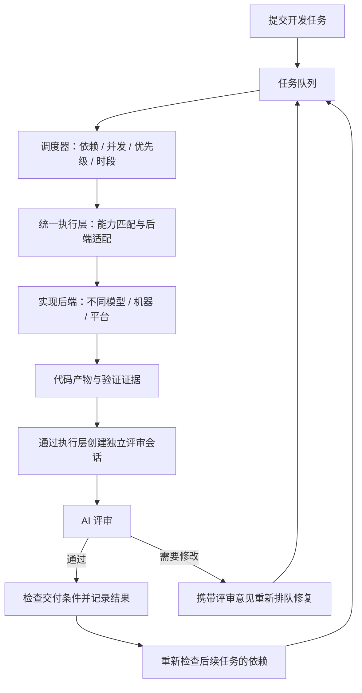

# starmap

以任务队列和可插拔执行层为核心的 AI 开发框架，协调不同模型、不同机器上的 Agent 并行开发，并由独立的 AI 会话评审交付结果。

将开发任务加入队列后，starmap 根据并发上限、任务依赖、优先级和执行时段安排工作，将任务分发给公司的 AI 开发平台、远端虚拟机中的 Agent 等实现端。目标是让开发任务能够持续推进，并利用峰谷计价安排适合延后的工作。

> 当前处于设计与文档阶段，尚无可运行实现。下文描述目标能力与设计；调度语义中的实现建议见[设计说明](docs/design.md)。

## 项目的两部分

### 全局 Rules

使用 AI 时通用的工作约束，可以独立于开发框架使用，也适用于队列之外的 AI 会话。

- 在明确的目标、范围和授权内自主推进工作。
- 用实际执行和验证结果支持结论，明确未验证事项。
- 根据风险选择流程，保留必要的上下文和失败原因。
- 遵守项目约束，保护凭据，保持修改和交付可追溯。

全局 Rules 定义共同的协作原则；项目规则与任务技能补充具体仓库和任务的要求。规则正文将逐步整理为可复用文件，目前原则记录在[设计说明](docs/design.md)中。

### 开发框架

由任务队列、调度器、统一执行层和独立评审组成，管理从任务入队到交付的生命周期。队列负责安排工作，执行层负责将工作交给具备所需能力的具体后端。

| 组成 | 职责 |
| --- | --- |
| 任务队列 | 保存开发任务、依赖关系、优先级和调度状态，支持插队与移出 |
| 调度器 | 根据并发容量、依赖、执行时段和实现端可用性，选择并派发可执行任务 |
| 统一执行层 | 抽象执行协议、能力和结果，通过适配器接入不同模型、机器及 AI 平台 |
| 独立 AI 评审 | 在独立于实现会话的上下文中检查需求满足情况、代码和验证证据，输出评审意见 |
| 执行与交付记录 | 保存执行尝试、版本、评审、失败原因和恢复信息 |

## 执行层：统一协议，多种后端

一个执行后端由运行环境、Agent 或平台、模型配置及能力声明共同描述。模型和机器分别配置：同一模型可以运行在不同机器的 Agent 中，同一环境也可以按平台支持情况选择不同模型。

| 维度 | 描述内容 |
| --- | --- |
| 运行环境 | 本机、远端虚拟机、容器，或由公司平台托管的环境 |
| Agent / 平台 | 实际负责理解任务、操作工具和生成产物的执行系统 |
| 模型配置 | 平台支持的模型及参数；平台不开放选择时由平台管理 |
| 能力与限制 | 仓库访问、工具及运行时、网络范围、可用容量、取消与恢复能力 |
| 调度属性 | 可用时段、价格策略、资源池和健康状态 |

任务可以指定所需能力和允许使用的后端，也可以显式指定模型或执行环境。调度器先筛选满足硬性要求的后端，再按优先级、容量和时段策略安排执行。无法匹配时保留任务并说明阻塞原因。

适配器将统一的任务输入转换为平台调用，并提供提交、状态查询、结果收集等接口。取消和会话恢复等可选能力需要明确声明。不同后端的结果统一记录代码版本、产物、验证证据和错误信息，便于评审及追溯。

独立评审同样通过执行层选择后端，但必须建立独立于实现过程的会话。切换模型或机器时，需要显式传递代码产物、任务上下文和评审意见；会话状态是否可迁移由后端能力决定。

例如，后端实现任务可以交给具备内网访问权限的公司平台，前端任务可以交给有浏览器工具的远端 Agent，评审则选择独立会话或另一模型。具体后端可替换，队列和调度逻辑复用统一协议。

## 队列与调度

- **并行开发**：无依赖且资源允许的任务可以同时推进，最大并发限制资源占用。
- **按依赖推进**：后续任务等待前置任务达到约定的交付条件，再使用其产物开展工作。
- **利用峰谷计价**：允许延期的任务可以等待低价时段，紧急任务按明确策略优先执行。
- **持续开发**：以 24 小时持续运行为目标，在任务完成或资源恢复后继续调度后续工作。
- **随时调整计划**：新任务可以插队，不再需要的任务可以移出队列。
- **独立检查结果**：实现与评审分离，评审不通过的任务进入修复流程。

队列还承担任务状态持久化和执行跟踪，使长时间运行、失败恢复和人工干预有据可查。实际成本收益及持续运行能力需要在实现后验证。

## 工作流程

全局 Rules 为实现和评审提供共同约束。独立评审要求使用不同于实现过程的 AI 会话；是否使用不同模型或服务商由接入方式决定。

实现端完成运行、评审通过、代码合并和任务交付分别记录。评审通过后，仍需满足任务约定的交付条件；推送、合并等操作遵循明确授权。

## 核心调度能力

| 能力 | 目标行为 |
| --- | --- |
| 最大并发 | 限制同时执行的工作，避免超过配置的资源容量 |
| 任务依赖 | 支持任务间的前置关系；依赖未满足时不派发，拒绝循环依赖 |
| 插队 | 调整待调度任务的优先级或顺序；仍需满足依赖和容量限制 |
| 移出队列 | 停止派发不再需要的任务，并明确处理其后续依赖 |
| 时段调度 | 按配置的价格时段和运行窗口安排任务，支持紧急任务的显式策略 |
| 持久化与恢复 | 保留队列、执行记录和产物；重启后核对远端执行状态再继续调度 |
| 评审与返工 | 独立评审不通过时，携带意见进入修复流程，并限制自动返工次数 |

首版已确定采用非抢占式插队，实现和评审分别设置容量，并受共享资源总上限约束。运行中任务取消后，确认已停止才释放额度；详见[技术设计](docs/tech-design.md)。

## 例子：并行开发一个功能

假设有四个任务：A 定义接口契约，B 实现后端，C 实现前端，D 进行联调；B 和 C 依赖 A，D 依赖 B 和 C。

当实现并发上限为 2 时，A 达到依赖约定的交付条件后，B 和 C 可以并行执行；两者交付后，D 才能开始。调度器需要把前置任务的实际代码或接口产物提供给后续任务，并处理分支集成问题。

此时新增紧急任务 E，可以将 E 提升到符合调度条件的待执行任务前面。按建议的非抢占策略，E 等待可用槽位，不中断正在执行的 B 或 C，也不绕过自己的前置依赖。允许延期的其他任务则可以留到配置的低价时段执行。

## 当前状态与实施路线

- [x] 整理项目定位、调度需求和任务约定模板。
- [ ] 将全局 Rules 整理为可独立使用的文件。
- [ ] 定义统一执行协议、能力声明和标准结果格式。
- [ ] 实现持久化任务队列、最大并发、依赖校验、插队和移出。
- [ ] 用模拟实现端与模拟评审端验证完整调度闭环。
- [ ] 接入一个真实实现端及独立 AI 评审会话，支持评审返工。
- [ ] 接入第二种执行后端，验证模型与运行环境可替换、调度核心可复用。
- [ ] 完善运行恢复、取消、隔离工作区和依赖产物集成。
- [ ] 加入峰谷时段策略，验证持续运行与成本表现。

第一版采用 Python、JSON 任务卡和 SQLite 状态存储，先用模拟端验证调度，再接入本地 Codex。实现和评审分别创建独立会话，任务使用独立 Git worktree；框架生成本地提交，不自动推送或合并主分支。当前没有可运行的 CLI 或软件包。

日常入口是向 AI 描述任务，由 AI 编写任务卡并调用框架。具体方案见[技术设计](docs/tech-design.md)，目前等待独立评审与作者最终 review。

## 文档

- [范围判断与自动恢复提案](docs/proposals/adaptive-scope-and-recovery.md)：针对必要改动越界和 rebase 后任务卡住的设计讨论，尚待确认。
- [设计说明](docs/design.md)：两部分的边界、调度语义、执行与评审机制。
- [技术设计](docs/tech-design.md)：已确认选择、模块、数据、执行协议及故障恢复方案。
- [实施路线](docs/roadmap.md)：分阶段实现及验收场景。
- [任务约定模板](docs/task-template.md)：任务目标、依赖、调度策略、评审和交付要求。

## 许可证

许可证待确定。
